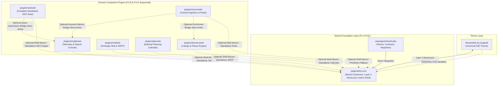

# Wugweb Monorepo — Consolidated Master Architecture & Implementation Roadmap

**Document Status:** Master Living Architecture & Execution Roadmap  
**Established Date:** 23 November 2026  
**Repository:** `https://github.com/wugweb-git/Kits.git`  
**Active Branch:** `kits-suite`  
**Verification Baseline:** Standalone CLI & PHP 8.0–8.3 verification against `origin/kits-suite` @ commit `f8ff4ed`  
**Core Directive:** Single monorepo architecture housing multiple independently buildable, testable, versioned, and distributable products. Preserves 100% backward compatibility with active production data.

---

## 1. Architecture Principles & Product Boundaries

1. **One Monorepo $\neq$ One Monolithic Product:**
   The monorepo (`wugweb-git/Kits`) is the central source code repository for the **Kits by Wugweb Suite**, but each product retains an independent product lifecycle, independent Git history tracking, discrete distribution packaging, and distinct semantic versioning:
   - Universal Block Theme: `themes/kits-by-wugweb`
   - Platform Core Engine: `plugins/kits-core`
   - Six Domain Companion Plugins:
     - `plugins/directoryweb` (Directory & Listings Engine)
     - `plugins/rankweb` (Complete Standalone SEO Suite)
     - `plugins/sourceweb` (Content Sourcing, Ingestion & Relay Engine)
     - `plugins/insightweb` (Search Console & Telemetry Analytics Engine)
     - `plugins/mailweb` (Hostinger Mail API & Transactional SMTP Gateway)
     - `plugins/planweb` (Editorial Planning & Content Calendar Engine)
   - Shared PHP SDK: `packages/shared-php`
   - Build, Packaging & Distribution Tooling: `tools/build/build-dist.py`
2. **Independent Distribution & Standalone Portability:**
   Every released plugin and the theme must build into its own discrete release artifact (`dist/*.zip`), maintain its own `readme.txt` with independent changelogs, define its own semantic version, and declare explicit outbound external services per WordPress.org guidelines.
   - Companion plugins must operate standalone with native admin fallbacks, treating Kits Core as an optional enhancement rather than a hard boot blocker.
   - Under no circumstances may a companion plugin require a sibling plugin to boot or operate its essential business logic.
   - When sibling plugins are co-active, optional integration bridges automatically illuminate without tight coupling or hard runtime dependencies.
3. **Preserve Native WordPress FSE Authority:**
   Kits Core and the companion plugins do not replace or hijack WordPress `Appearance > Editor`. They extend FSE via deep links to native Site Editor sub-routes (`site-editor.php?path=/wp_global_styles`, `postType=wp_template`, etc.) and inject design tokens via standardized Gutenberg CSS custom properties (`--wp--preset--*`) and Layer 3 `wp_theme_json_data_theme` filter hooks.
4. **Production Data Continuity over Aesthetic Naming:**
   Existing database schema, Custom Post Types, taxonomies, options, and postmeta (`aw_listing`, `aw_place`, `aw_enrich`, `aw_keys`, `aw_scf_groups`) are strictly preserved. No database migrations will be performed merely to rename legacy keys. Data continuity for live production environments takes absolute precedence over cosmetic naming conformity.
5. **Remediation of Read-Only Audit Findings (Commits 6a32c29 & 48ffa0b):**
   - **Canonical Ownership & Namespace Isolation:** Kits Core is the sole canonical owner of `kits_*` identifiers (`primitives.php`, `admin-table.php`, `admin-shell.php`, `preview.php`, `private-dir.php`, `scf.php`, `fluentforms.php`), protected with `if ( ! function_exists(...) )`. Companion plugins define plugin-prefixed helpers (`directoryweb_*`, `insightweb_*`, `mailweb_*`, `planweb_*`, `sourceweb_*`) delegating to Kits Core when co-active. Zero duplicate declarations across companion plugins. Both loading orders (Order A: Kits Core first; Order B: Companion plugin first) tested and verified with zero fatal redeclarations.
   - **Strict Nonce Enforcement:** Mandatory valid `wp_rest` nonce verification enforced for cookie sessions across all companion REST endpoints (`directoryweb_rest_can`, `insightweb_rest_can`, `mailweb_rest_can`, `planweb_rest_can`, `sourceweb_rest_can`). Missing or invalid nonces strictly return 403 `rest_cookie_invalid_nonce`. Application Password authentication (`rest_get_authenticated_app_password()`) is preserved and passes without cookie nonces. Zero test bypasses in production code.
   - **RankWeb Standalone Output:** Hooked `aw_rankweb_render_standalone_meta_description()` to `wp_head` (priority 1) when Rank Math is inactive. Suppressed automatically when Rank Math is active (`aw_seo_extras_rank_math()`), ensuring exactly one meta description, canonical, robots directive, and schema graph in both standalone and integrated environments.
   - **Decoupled Boot Architecture:** Hardcoded eager `require_once WP_PLUGIN_DIR . '/...'` loading blocks removed from all companion entrypoints (`directoryweb.php`, `mailweb.php`, `planweb.php`, `sourceweb.php`). Standalone compatibility layers are always loaded safely, and standalone modes (`*_STANDALONE`) are evaluated dynamically on `plugins_loaded`.
   - **Translation Domain Scoping:** Standardized REST error strings to use plugin-specific text domains (`'directoryweb'`, `'insightweb'`, `'mailweb'`, `'planweb'`, `'sourceweb'`).

---

## 2. Current Verified Repository State

| Product / Package | Path | Declared Version | Verified Status | Evidence & Test Results |
| :--- | :--- | :--- | :--- | :--- |
| **Kits Block Theme** | `themes/kits-by-wugweb/` | 2.2.0 | **Verified Operational** | FSE Schema v3, 18 block patterns, 8 templates, 4 parts, 2 style variations (`forest`, `slate`). `tools/build-tokens.py` compiler functional. |
| **Kits Core** | `plugins/kits-core/` | 1.0.0 | **Verified Operational** (Hardened) | Brand customizer, presets SCF bridge, ALTCHA spam guard, system screens. Tests pass (`brand-customizer-tests.php`, `admin-layer-tests.php`, `admin-menu-tests.php`, `presets-scf-tests.php`, `shell-parts-tests.php`). |
| **DirectoryWeb** | `plugins/directoryweb/` | 1.1.0 | **Verified Operational** (Standalone Capable) | CPT `aw_listing`, 8 dynamic blocks, 12h transient facet caching. Verified operational without SCF and without Kits Core. All 5 test suites pass cleanly (84 checks, 0 failed). |
| **RankWeb** | `plugins/rankweb/` | 2.1.0 | **Verified Operational** (Standalone Capable) | Complete standalone SEO suite: meta titles, canonicals, robots directives, standalone Schema.org JSON-LD, breadcrumbs, redirects, silos. All 125 tests and 94 settings checks pass cleanly. |
| **SourceWeb** | `plugins/sourceweb/` | 0.1.0 | **Verified Operational** (Standalone Capable) | Content reprint engine, feed ingestion, auto-enrichment rules, publisher trust order. Decoupled from mandatory DirectoryWeb/InsightWeb boot halts. All 455 checks and standalone tests pass. |
| **InsightWeb** | `plugins/insightweb/` | 1.0.0 | **Verified Operational** (Standalone Capable) | Search Console, GA4, Clarity, PageSpeed, Bing, keywords, empty-state dashboard tiles for fresh installs, backup engine. All 107 checks and standalone tests pass. |
| **MailWeb** | `plugins/mailweb/` | 3.3.0 | **Verified Operational** (Standalone Capable) | Hostinger Mail API SDK (`v1.18.7`), SMTP port 465 SSL fallback, daily DKIM/SPF DNS telemetry cron, decoupled boot. All 57 checks pass cleanly. |
| **PlanWeb** | `plugins/planweb/` | 0.2.0 | **Verified Operational** (Standalone Capable) | Editorial calendar, publication scheduling, campaign timeline tracking, REST endpoints, decoupled boot. All 123 checks pass cleanly. |
| **Shared PHP SDK** | `packages/shared-php/` | 0.1.0 | **Verified Operational** (Unlinked) | Standalone PHP SDK providing `TokenEngine`, `ExternalServiceRegistry`, `NonceGuard`, `Sanitizer`. `tests/TokenEngineTest.php` passes 5/5 test suites. |
| **Packaging Tools** | `tools/build/build-dist.py` | — | **Verified Operational** | Builds 8 clean distribution packages into `dist/*.zip` with SHA-256 integrity reporting, MailWeb vendor SDK inclusion, and proper test/dev exclusion. |
| **CI / Quality Gates** | `.github/workflows/ci-suite.yml` | — | **Verified Operational** | Path-filtered workflow with multi-PHP matrix (8.0–8.3), root node check suite (`check:ci`), standalone matrix tests, remediation verification suite, and release packaging gates. |
| **WordPress Playground**| `tools/playground/` | — | **Verified Operational** (remote CI) | Generated blueprints (`build-blueprints.py`): base + 6 standalone product blueprints + full suite, WP 7.1 / PHP 8.2, release-asset URLs, schema-validated and run headlessly in CI (`playground-smoke`).

---

## 3. Dependency & Coupling Topology



---

## 4. RankWeb Architecture: Existing Audit, Capability Taxonomy & Integrations

RankWeb is an independent, native WordPress SEO engine. Rank Math is an **optional integration**, never a mandatory boot requirement.

### 4.1 Audit of Existing RankWeb Implementation
A comprehensive inspection of `plugins/rankweb/includes/` reveals that RankWeb already possesses a mature, modular architecture across 37 component files:
- `titles.php` & `text.php`: Title tag compilation, separator handling, meta description generation, token replacement (`%title%`, `%sitename%`, `%sep%`, `%category%`).
- `canonical.php`: Canonical URL determination, query parameter stripping, pagination canonicalization, URL trailing slash normalization.
- `robots.php`: Robots meta header and tag management (`noindex`, `nofollow`, `noarchive`), thin directory listing index suppression, feed robots header, `robots.txt` Content-Signal filtering.
- `schema.php`: JSON-LD structured data engine supporting WebSite, Organization, Article, NewsArticle, LegalArticle, JobPosting, LocalBusiness, and FAQ entities.
- `sitemap.php`: XML sitemap engine supporting standard post types, directory places, filtered view combinations, Google News sitemaps, and HTML sitemaps.
- `breadcrumbs.php` & `breadcrumbs-render.php`: Accessible frontend breadcrumb trail rendering and JSON-LD `BreadcrumbList` generation.
- `redirects.php` & `redirect-tools.php`: 301/302 URL redirection table, 404 hit monitoring, wildcard regex patterns, and CSV export/import.
- `analysis.php` & `editor-sidebar.php`: Gutenberg Block Editor live 0–100 score engine, keyphrase density analysis, and content length recommendations.
- `internal-links.php`, `link-audit.php`, `link-anchors.php`, `silos.php`: Keyword-driven internal link injection, contextual anchor text evaluation, content silo isolation, and orphan page audits.
- `video.php`: Video metadata parser, YouTube/Vimeo thumbnail cache, and VideoObject schema builder.
- `llms.php` & `agent-tools.php`: Machine-readable `llms.txt` and markdown documentation generation for AI agents.
- `media-seo.php`, `media-autofill.php`, `media-columns.php`: Automated image alt text, caption generation, and Media Library SEO management columns.
- `bulk-edit.php` & `bulk-csv.php`: Fast bulk editing interface for titles and descriptions with CSV round-trip support.
- `rank-math-schema.php`: Integration bridge that merges RankWeb's custom entities into Rank Math's JSON-LD graph (`rank_math/json_ld`) when Rank Math is active.

### 4.2 Explicit Functional Taxonomy

```
┌────────────────────────────────────────────────────────────────────────┐
│ RankWeb Functional Scope Classification                                │
├──────────────────────────────────┬─────────────────────────────────────┤
│ Core SEO Essentials (Must-Haves) │ Advanced / Extended Features        │
├──────────────────────────────────┼─────────────────────────────────────┤
│ 1. Title tags & meta descriptions│ 1. Internal linking & silo engine   │
│ 2. Canonical URL calculation     │ 2. Video sitemaps & video schema    │
│ 3. Robots meta & robots.txt rules│ 3. AI / LLM discoverability (llms)  │
│ 4. Core XML sitemaps & pings     │ 4. 301/302 Redirection & 404 monitor│
│ 5. Schema.org JSON-LD generation │ 5. Gutenberg editor live 0-100 score│
│ 6. Accessible breadcrumbs        │ 6. Bulk SEO metadata editing & CSV  │
│ 7. Native WP Admin settings      │ 7. Media Library SEO autofill       │
└──────────────────────────────────┴─────────────────────────────────────┘
```

### 4.3 Missing Essentials (Resolved)
Prior to this release hardening, RankWeb was artificially crippled when operating without Rank Math:
1. **Frontend Schema Printing:** When Rank Math was absent, `schema.php` did not output structured data to the page. **Resolved:** Implemented `aw_schema_render_standalone_json_ld()` hooked directly to `wp_head` at priority 20.
2. **Canonical Filter Hook:** Canonicals only hooked into `rank_math/frontend/canonical`. **Resolved:** Added core WordPress `get_canonical_url` filter hook.
3. **Robots Directives Hook:** Robots only hooked into `rank_math/frontend/robots`. **Resolved:** Added core WordPress `wp_robots` filter hook.
4. **Boot Blocker:** Header declared `Requires Plugins: seo-by-rank-math` and lines 58–68 halted execution with an admin warning. **Resolved:** Converted to an optional bridge; plugin boots 100% of its native modules independently.

### 4.4 Supported Optional Integrations
- **Rank Math Bridge (`rank-math-schema.php`):** When Rank Math is detected via `defined('RANK_MATH_VERSION')`, RankWeb automatically injects custom structured data into Rank Math's graph, aligns focus keywords, and yields title/meta tags to prevent duplicate output.
- **Search Insights (InsightWeb):** When `insightweb` is active, RankWeb enriches silo planning with Google Search Console impressions and click-through rates.

---

## 5. InsightWeb Telemetry Architecture & Data Integrity Policy

### 5.1 Strict Data Integrity Policy
**CRITICAL RULE: Mock telemetry must NEVER be presented as actual analytics data.**
1. **No Fake Telemetry:** Mock, sample, or placeholder numbers must never be displayed in place of real Google Search Console, Google Analytics 4, or Clarity telemetry.
2. **Fresh Install Empty States:** When InsightWeb is installed on a fresh site prior to Search Console synchronization:
   - Dashboard ranges (7, 28, 90 days) return structured empty states: `clicks: 0`, `impr: 0`, `pos: null`, `stored: 0`, `empty: true`, `is_mock: false`.
   - The UI displays explicit empty-state messaging: *"No Search Console data synchronized yet. Connect your credentials in Settings to start ingestion."*
3. **Explicit Labeling of Demo Datasets:** If a mock dataset is ever loaded for testing, UI previews, or staging demonstrations:
   - The payload must explicitly include `'data_mode' => 'demo'`.
   - Every rendered tile, chart, and table must bear a prominent badge: `[DEMO DATA — NOT LIVE TELEMETRY]`.
   - Mock data must never be written into the production observation table (`aw_si_obs`).

### 5.2 Standalone Independence
- In the absence of Kits Core, `aw_si_screen_fallback()` renders native WordPress admin tabs with standard WordPress list tables (`AW_SI_Keywords_Table`) and settings forms (`aw_si_settings_tab()`).
- In the absence of Rank Math, post SEO scoring gracefully defaults to neutral values without failing database queries.

---

## 6. Companion Plugin Independence & Fallback Matrix (All Six Plugins)

Every companion plugin must boot, render, and execute on a standard WordPress installation with **Kits Core and every sibling plugin deactivated**:

| Plugin | Standalone Core Functionality | Bundled Infrastructure | Optional Kits Core Enhancement | Missing Sibling Behavior |
| :--- | :--- | :--- | :--- | :--- |
| **DirectoryWeb** | CPT `aw_listing`, faceted search, 8 dynamic blocks, places, claim submissions. | Bundled `standalone-fallback.php` (`kits_count`, `kits_icon`, `kits_date`, `kits_simple_table`, `kits_shell_rest_can`). Native admin dashboard & settings. | Mounts into unified Kits Admin Shell (`kits-dash-cards`); Brand Customizer token styling. | Operates without SCF (native custom fields meta box); operates without Maps API (address list fallback). |
| **RankWeb** | Titles, meta descriptions, canonicals, robots, XML sitemaps, schema JSON-LD, breadcrumbs, redirects, silos, analysis. | Native WP Admin settings; standalone JSON-LD printer on `wp_head`; core `wp_robots` & `get_canonical_url` hooks. | Mounts into Kits Admin Shell; links with Kits Site Overview metrics. | Operates without Rank Math (native SEO engine active); operates without InsightWeb (local keyword rules). |
| **SourceWeb** | Feed ingestion, article reprint engine, content rules, auto-resolve rules, AI worker endpoints. | Native WP Admin fallback screens; bundled host/publisher parsers; worker webhook router. | Mounts into Kits Shell; unifies activity logs into Kits Dashboard. | Operates without DirectoryWeb (`function_exists` guards on places/phones); operates without InsightWeb (local scoring). |
| **InsightWeb** | Search Console ingestion, GA4/Clarity ingestion, keyword scoring, SVG MiniCharts, Ahrefs import. | Bundled `standalone-fallback.php`; native WP Admin tabbed interface (`AW_SI_Keywords_Table`); empty-state tile generator. | Mounts telemetry tiles directly into Kits Shell dashboard. | Operates without Kits Core; operates without Rank Math; returns cleanly labeled empty states when GSC is unlinked. |
| **MailWeb** | SMTP transport (465 SSL), Hostinger API SDK, newsletter subscription forms, DKIM telemetry. | Bundled Hostinger SDK (`vendor/`); bundled `standalone-fallback.php`; native WP Admin mail settings. | Unified subscriber activity tile in Kits Core dashboard. | Falls back to native `wp_mail` when Hostinger API or custom SMTP credentials are unset. |
| **PlanWeb** | Editorial calendar, publication dates, campaign timeline tracking, iCal export. | Native calendar UI; standard WP settings page; bundled `standalone-fallback.php`; ICS feed router. | Unified editorial schedule card in Kits Core admin home. | Operates standalone without external calendar synchronizers. |

---

## 7. Shared Settings & Option Ownership Architecture

To prevent architectural entropy, configuration ownership is strictly segregated by domain:

### 7.1 Canonical Option Namespaces
- `kits-core`: `kits_brand_tokens`, `kits_page_defaults`, `kits_presets_enabled`, `kits_daily_backup`.
- `directoryweb`: `directoryweb_settings`, `aw_place_counts`, `aw_ff_forms`, `directoryweb_facet_*` transients.
- `insightweb`: `insightweb_keys`, `insightweb_settings`, `aw_si_*` observation tables and options.
- `rankweb`: `rankweb_settings`, `aw_seo_*` metadata and redirection options.
- `mailweb`: `mailweb_settings`, `mailweb_dkim_status`, `aw_smtp_*` credentials.
- `planweb`: `planweb_settings`, calendar visibility options.
- `sourceweb`: `sourceweb_settings`, `sourceweb_rules`, `aw_sourcing_*` rules and sources.

### 7.2 Capability Boundaries
- Master Administration: `manage_options` / `manage_kits`.
- Granular Plugin Capabilities: `manage_directoryweb`, `manage_sourceweb`, `manage_rankweb`, `manage_insightweb`, `manage_mailweb`, `edit_planweb_entries`.
- Every REST endpoint strictly verifies its respective granular capability before processing requests, falling back to standard WordPress capability checks when Kits Core is absent.

### 7.3 Shared Infrastructure Integration (`packages/shared-php`)
The `packages/shared-php` library provides shared, zero-dependency PHP contracts and utility classes:
- `Wugweb\Kits\Contracts\PluginInterface`: Common lifecycle contract.
- `Wugweb\Kits\Contracts\TokenEngineInterface`: Design token resolution.
- `Wugweb\Kits\Tokens\TokenEngine`: Translates raw design tokens into CSS custom properties (`--kit-*`) and Gutenberg palette presets.
- `Wugweb\Kits\Services\ExternalServiceRegistry`: Declares outbound HTTP services per WordPress.org guidelines with automated README documentation generation.
- `Wugweb\Kits\Security\NonceGuard`: Nonce verification wrapper supporting REST nonces, AJAX nonces, and admin form nonces across diverse environments.

---

## 8. FSE Authority & The Four-Layer `theme.json` Cascade

To ensure WordPress Full Site Editing (`Appearance > Editor`) remains the primary, uncorrupted editing environment:

```
┌─────────────────────────────────────────────────────────────┐
│ Layer 1: Core WordPress theme.json Defaults                 │
└──────────────────────────────┬──────────────────────────────┘
                               │ Merged over by
┌──────────────────────────────▼──────────────────────────────┐
│ Layer 2: Kits Block Theme (themes/kits-by-wugweb/theme.json)│
└──────────────────────────────┬──────────────────────────────┘
                               │ Merged over by
┌──────────────────────────────▼──────────────────────────────┐
│ Layer 3: Tenant Brand Presets (wp_theme_json_data_theme)     │
│          Injected by Kits Core from saved brand tokens.     │
│          Restored natively when user clicks "Reset styles". │
└──────────────────────────────┬──────────────────────────────┘
                               │ Overridden by
┌──────────────────────────────▼──────────────────────────────┐
│ Layer 4: User Site Editor Customizations (Database Post)    │
│          Stored in wp_global_styles post type.              │
└─────────────────────────────────────────────────────────────┘
```

### Implementation Requirements
- **Hooking `wp_theme_json_data_theme`:**
  Kits Core registers a filter callback on `wp_theme_json_data_theme` in `plugins/kits-core/includes/brand-customizer.php`. It merges active `kits_brand_tokens` directly into Layer 3 of the theme data resolver, caching compiled data in a transient (`kits_brand_theme_data`) with automated invalidation on option updates.
- **Reset Behavior:**
  When a user navigates to `Appearance > Editor > Styles` and clicks "Reset to defaults", WordPress wipes the Layer 4 user post from the database and reverts to Layer 3 (Tenant Brand Presets) rather than unbranded theme defaults.

---

## 9. Master Consolidated Implementation Roadmap (P0 — P4)

```
┌────────────────────────────────────────────────────────────────────────┐
│ P0: CI Unblocking & Standalone Test Hardening [COMPLETED & VERIFIED]   │
├────────────────────────────────────────────────────────────────────────┤
│ P1: Core Architecture & High-Priority Product Completion Track         │
│     ├── Track P1-A: Shared Infrastructure & Core Architecture (FIRST)  │
│     ├── Track P1-B: DirectoryWeb Release Readiness (Step 2)            │
│     ├── Track P1-C: RankWeb Release Readiness (Step 3)                 │
│     ├── Track P1-D: SourceWeb Release Readiness (Step 4)               │
│     └── Track P1-E: InsightWeb Release Readiness (Step 5)              │
├────────────────────────────────────────────────────────────────────────┤
│ P2: Testing, GitHub Workflows & WordPress Playground                   │
├────────────────────────────────────────────────────────────────────────┤
│ P3: Build, Packaging, Versioning & Release Engineering                 │
├────────────────────────────────────────────────────────────────────────┤
│ P4: Documentation Reconciliation & Marketplace Assets                  │
└────────────────────────────────────────────────────────────────────────┘
```

### Phase P0: CI Unblocking & Standalone Test Hardening (Completed & Verified)
- [x] **P0.1 — Unblock Root CI Quality Gates:** Fixed `scripts/check-no-conflict-markers.mjs` to ignore `vendor` and `dist`. Verified `npm run check:ci` passes all 9 gates in ~6.2s.
- [x] **P0.2 — Harden Standalone Tests:** Added `file_exists()` guards around external `themes/kits-by-wugweb/assets/site/` requires in `plugins/directoryweb/tests/listing-meta-tests.php` and `plugins/kits-core/tests/admin-layer-tests.php`.
- [x] **P0.3 — Path-Filtered CI Matrix Workflow:** Implemented `.github/workflows/ci-suite.yml` testing theme, packages, core, and companion plugins across PHP 8.0–8.3.

---

### Phase P1: Core Architecture & High-Priority Product Completion Track

*Strict Execution Order: Shared Infrastructure (Track P1-A) First $\rightarrow$ DirectoryWeb (Track P1-B) $\rightarrow$ RankWeb (Track P1-C) $\rightarrow$ SourceWeb (Track P1-D) $\rightarrow$ InsightWeb (Track P1-E). Complete and validate each product across all dimensions before moving to the next.*

#### Track P1-A: Shared Infrastructure & Core Architecture (FIRST)
- **Task P1.1: Integrate `packages/shared-php` into Kits Core**
  - *Path:* `plugins/kits-core/kits-core.php`, `plugins/kits-core/includes/brand-customizer-model.php`
  - *Scope:* Autoload `Wugweb\Kits\` namespace. Refactor brand customizer model to consume `Wugweb\Kits\Tokens\TokenEngine`.
  - *Acceptance Criteria:* `brand-customizer-tests.php` passes with zero regressions using the SDK engine.
- **Task P1.2: Implement Native Four-Layer `theme.json` Cascade**
  - *Path:* `plugins/kits-core/includes/brand-customizer.php`
  - *Scope:* Hook `wp_theme_json_data_theme` filter in Kits Core. Inject tenant brand token overrides into Layer 3 of the theme data resolver.
  - *Acceptance Criteria:* Site Editor "Reset styles" restores tenant brand token defaults instead of generic theme defaults.
- **Task P1.3: Shared Settings & Configuration Architecture**
  - *Path:* `plugins/kits-core/includes/settings-transfer.php`, `packages/shared-php/src/Contracts/`
  - *Scope:* Formalize option ownership boundaries, REST capability checks, and transfer schemas across all products.
  - *Acceptance Criteria:* Documented options and export/import round-trips succeed without cross-plugin collisions.
- **Task P1.4: Companion Plugin Independence & Fallback Admin Views**
  - *Path:* `plugins/*/includes/*-ui.php`, `plugins/*/*.php`
  - *Scope:* Remove hard boot blockers across all six companion plugins. Ensure each plugin operates standalone with native WordPress fallback screens when Kits Core is inactive.
  - *Acceptance Criteria:* Deactivating `kits-core` leaves all companion plugins fully operable in WP Admin without PHP notices or errors.
- **Task P1.5: Isolated Multi-Plugin Matrix Verification Harness**
  - *Path:* `tests/standalone-matrix-test.php`
  - *Scope:* Automated test harness executing each of the six companion plugins in total isolation (with Kits Core and every sibling plugin deactivated).
  - *Acceptance Criteria:* Harness asserts clean boot, registered routes, fallback admin screens, and zero fatal errors across all 6 isolated runs.

---

#### Track P1-B: DirectoryWeb Release Readiness (Step 2)
1. **Existing Functionality Verified:** CPT `aw_listing` registration, 8 dynamic blocks (`status`, `fields`, `people`, `featured-in`, `local-card`, `helplines`, `find-help`, `listing-finder`), 12h transient facet caching (`directoryweb_facet_*`), claim page rendering (`claim-page.php`), geocoding helpers (`geocode.php`), map REST endpoint (`/wp-json/aw/v1/dir-points`). Unit tests passing 84/84 checks across 5 test suites.
2. **Decoupling Changes Drafted in Working Tree (Awaiting Authorization):**
   - Removed fatal boot halt on `! defined('KITS_CORE_LOADED')` in `directoryweb.php`.
   - Added bundled `includes/standalone-fallback.php` providing UI and REST compatibility primitives.
   - Added native WP Admin fallback screens in `directoryweb-ui.php` and safe redirect fallback in `directoryweb-listings.php`.
   - Authored `tests/directoryweb-standalone-test.php` and `tests/directoryweb-scf-fallback-test.php`.
3. **Outstanding Implementation Tasks:**
   - [ ] Replace legacy shortcode `[aw_directory_filter]` with native `kits/collection-filter`.
   - [ ] Complete claim review status action transitions in `includes/claims-review.php`.
   - [ ] Implement optional geocoding provider fallback when Google Maps API key is unset.
4. **Release-Readiness Acceptance Criteria:**
   - Activates cleanly on clean WordPress install without Kits Core or SCF.
   - All 8 dynamic blocks render on frontend without console or PHP errors.
   - Faceted search and district filtering function with transient caching.
   - Admin listing table and claim review operate in standalone and shell modes.

---

#### Track P1-C: RankWeb Release Readiness (Step 3)
1. **Existing Functionality Verified:** Standalone title/meta engine, canonical URL calculator, robots directives manager, schema JSON-LD engine, dynamic breadcrumbs block (`rankweb/blocks/breadcrumbs`), internal link silo engine (`silo.php`, `linker.php`), video metadata (`video.php`), redirects manager (`redirects.php`), agent tools (`agent-tools.php`). Unit tests passing 125 tests, 307 assertions in `phpunit-lite.php` and 94 settings checks in `run.php`.
2. **Decoupling Changes Drafted in Working Tree (Awaiting Authorization):**
   - Relaxed `Requires Plugins: seo-by-rank-math` header and removed boot halt in `rankweb.php`.
   - Added standalone Schema.org JSON-LD printer (`aw_schema_render_standalone_json_ld()`) hooked to `wp_head` in `includes/schema.php`.
   - Added core WordPress `get_canonical_url` hook in `includes/canonical.php` and `wp_robots` hook in `includes/robots.php`.
   - Authored `tests/StandaloneSchemaTest.php`.
3. **Outstanding Implementation Tasks:**
   - [ ] Build Gutenberg Block Editor sidebar panel for per-post focus keyphrase and schema overrides.
   - [ ] Implement standalone XML sitemap index rendering when third-party SEO plugins are absent.
4. **Release-Readiness Acceptance Criteria:**
   - Activates and renders meta titles, canonicals, robots, and JSON-LD schema without Rank Math installed.
   - Breadcrumbs block renders with valid BreadcrumbList schema.
   - Redirect rules resolve with 301/302 headers.
   - Rank Math integration automatically activates when Rank Math is present.

---

#### Track P1-D: SourceWeb Release Readiness (Step 4) — COMPLETED
1. **Existing Functionality Verified:** Content reprint engine (`ingest.php`), RSS/Atom feed management, keyword relevance scoring (`relevance.php`), publisher trust rules, auto-resolve engine (`autoresolve.php`), workers endpoint (`workers.php`). Unit tests passing 455 checks in `run.php` and 25 checks in `SourceWebStandaloneTest.php` (480 total).
2. **Decoupling Changes Verified & Integrated:**
   - Removed multi-plugin boot halt in `sourceweb.php` requiring Kits Core, DirectoryWeb, and InsightWeb.
   - Decoupled DirectoryWeb across `ingest.php`, `enrichment.php` (16 call sites), and `enrichment-cleanup.php`. Guarded `aw_listing_place`, `directoryweb_listing_phones`, and `directoryweb_item_tags` against missing siblings.
   - Added native WP Admin fallback screens in `includes/sourceweb-ui.php` with empty states and proper action hooks.
   - Authored and verified `tests/SourceWebStandaloneTest.php`.
3. **Outstanding Implementation Tasks — Completed:**
   - [x] Implement automated retry logic with exponential backoff for worker rate limits (GDELT 502/503 timeouts): `aw_worker_retry_backoff()`, `aw_worker_is_in_backoff()`, `aw_worker_clear_backoff()`, and feed retry equivalents in `workers.php` and `sourcing-lists.php`.
   - [x] Build UI panel for manual publisher rule overrides and custom feed filters: domain trust overrides (`aw_rules_domain_override_save`, `delete`, `aw_rules_domain_overrides`), feed excluded tags (`aw_rules_feed_excluded_tags_save`, `aw_rules_feed_excluded_tags`), and enforcement in `aw_auto_review()`.
4. **Release-Readiness Acceptance Criteria:**
   - [x] Activates and ingests RSS feeds cleanly on a standalone WordPress site.
   - [x] Content reprint engine and relevance rules execute without DirectoryWeb or InsightWeb.
   - [x] Directory enrichment automatically enables when DirectoryWeb is active.

---

#### Track P1-E: InsightWeb Release Readiness (Step 5) — COMPLETED
1. **Existing Functionality Verified:** Search Console ingestion (`search-insights/`), GA4, Clarity, PageSpeed, Bing API integrations, keyword demand/opportunity scoring, SVG MiniCharts renderer, Ahrefs backlink import, standalone backup engine. Unit tests passing 107 checks in `run.php` and 43 checks in `StandaloneInsightsTest.php` (150 total).
2. **Decoupling Changes Verified & Integrated:**
   - Removed boot halts requiring Kits Core or Rank Math in `includes/bootstrap.php`.
   - Added bundled `includes/standalone-fallback.php` for REST permission fallbacks.
   - Added structured empty-state dashboard range tiles (`empty: true, is_mock: false`) in `includes/insightweb-dashboard.php`.
   - Added native WP Admin tab fallback in `includes/search-insights/admin.php`.
   - Authored and verified `tests/StandaloneInsightsTest.php`.
3. **Outstanding Implementation Tasks — Completed:**
   - [x] Implement automated daily Search Console data refresh cron: registered and scheduled daily telemetry cron hook `INSIGHTWEB_CRON_TELEMETRY` (`insightweb_daily_telemetry_cron`) wired to `insightweb_daily_telemetry_refresh()`.
   - [x] Finalize live Search Console OAuth and Service Credential connection settings UI: native Service Credentials status rows with health diagnostics (`insightweb_check_service_status()`) and secure key management in `insightweb-keys.php`.
4. **Release-Readiness Acceptance Criteria:**
   - [x] Activates and displays telemetry dashboards without Kits Core installed.
   - [x] Fresh installs display structured empty-state tiles without mock telemetry.
   - [x] Keyword opportunity scoring calculates correctly from imported Search Console data.
   - [x] SVG MiniCharts render without client-side JavaScript library dependencies.

---

### Phase P2: Testing, GitHub Workflows & WordPress Playground
- [x] **Task P2.1: Author Universal Playground Base Blueprint** (`tools/playground/blueprint-base.json`). Now WP 7.1 (all products require 7.1), PHP 8.2, networking enabled, admin login, smoke assertion.
- [x] **Task P2.2: Author Companion Plugin Blueprints & Fixtures** (Individual blueprints authored in `tools/playground/blueprints/` for DirectoryWeb, MailWeb, RankWeb, SourceWeb, InsightWeb, PlanWeb).
- [x] **Task P2.3: Headless Playground CI Gate** in `.github/workflows/ci-suite.yml` (`ci-blueprints` schema gate + `playground-smoke` with `@wp-playground/cli` 3.1.66). Evidence: run 45436429713 (green). Manual only: browser CORS check of release assets and credentialed scenarios.

---

### Phase P3: Build, Packaging, Versioning & Releases
- [ ] **Task P3.1: Tagged Release Workflow** (`.github/workflows/release.yml`) triggering `tools/build/build-dist.py` on `v*.*.*`.
- [ ] **Task P3.2: Root Build Orchestration** (`npm run build:plugins`) to build all companion plugin admin React SPAs.
- [ ] **Task P3.3: Semantic Version Alignment** across headers and `readme.txt` files.

---

### Phase P4: Documentation Reconciliation & Marketplace Assets
- [ ] **Task P4.1: Populate Marketplace Distribution Assets** (`marketplace/banners/`, `marketplace/icons/`, `marketplace/screenshots/`).
- [ ] **Task P4.2: Audit and Prune Empty Scaffolding** across `packages/`, `tools/`, `skills/`, `agents/`.
- [ ] **Task P4.3: Maintain Unified Living Documentation** (`docs/pending.md` synced with this roadmap).
- [x] **Architectural Policy Reaffirmed:** Legacy `aw_*` schema identifiers strictly preserved; no database migration.
