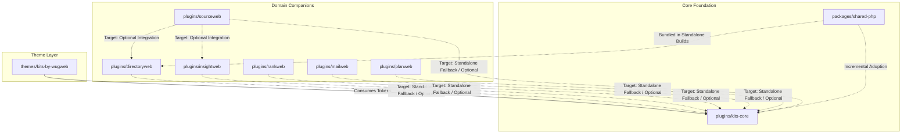

# Wugweb Monorepo — Consolidated Master Architecture & Implementation Roadmap

**Document Status:** Master Living Architecture & Execution Roadmap  
**Established Date:** 23 November 2026  
**Repository:** `https://github.com/wugweb-git/Kits.git`  
**Active Branch:** `kits-suite`  
**Verification Baseline:** Standalone CLI & PHP 8.5 verification against `origin/kits-suite` @ commit `f8ff4ed`  
**Core Directive:** Single monorepo architecture housing multiple independently buildable, testable, versioned, and distributable products. Preserves 100% backward compatibility with active production data.

---

## 1. Architecture Principles & Product Boundaries

1. **One Monorepo $\neq$ One Monolithic Product:**
   The monorepo (`wugweb-git/Kits`) is the central repository for the **Kits by Wugweb Suite**, but each product retains an independent lifecycle:
   - Universal Block Theme: `themes/kits-by-wugweb`
   - Platform Core: `plugins/kits-core`
   - Six Domain Companions: `plugins/directoryweb`, `plugins/insightweb`, `plugins/rankweb`, `plugins/mailweb`, `plugins/planweb`, `plugins/sourceweb`
   - Shared PHP SDK: `packages/shared-php`
   - Build & Packaging: `tools/build/build-dist.py`
2. **Independent Distribution & Standalone Operation:**
   Every released plugin and the theme must build into its own discrete release artifact (`dist/*.zip`), maintain its own `readme.txt` with independent changelogs, define its own semantic version, and declare explicit outbound external services per WordPress.org guidelines. Companion plugins must operate standalone with native admin fallbacks, treating Kits Core as an optional enhancement rather than a hard boot blocker.
3. **Preserve Native WordPress FSE Authority:**
   Kits Core and the companion plugins do not replace or hijack WordPress `Appearance > Editor`. They extend FSE via deep links to native Site Editor sub-routes (`site-editor.php?path=/wp_global_styles`, `postType=wp_template`, etc.) and inject design tokens via standardized Gutenberg CSS custom properties (`--wp--preset--*`).
4. **Production Data Continuity over Aesthetic Naming:**
   Existing database schema, Custom Post Types, taxonomies, options, and postmeta (`aw_listing`, `aw_place`, `aw_enrich`, `aw_keys`, `aw_scf_groups`) are strictly preserved. No database migrations will be performed merely to rename legacy keys.

---

## 2. Current Verified Repository State

| Product / Package | Path | Declared Version | Verified Status | Evidence & Test Results |
| :--- | :--- | :--- | :--- | :--- |
| **Kits Block Theme** | `themes/kits-by-wugweb/` | 2.2.0 | **Verified Operational** | FSE Schema v3, 18 block patterns, 8 templates, 4 parts, 2 style variations (`forest`, `slate`). `tools/build-tokens.py` compiler functional. |
| **Kits Core** | `plugins/kits-core/` | 1.0.0 | **Verified Operational** (Hardened) | Brand customizer, presets SCF bridge, ALTCHA spam guard, system screens. Tests pass (`brand-customizer-tests.php`, `admin-layer-tests.php`, `admin-menu-tests.php`, `presets-scf-tests.php`, `shell-parts-tests.php`). |
| **DirectoryWeb** | `plugins/directoryweb/` | 1.1.0 | **Verified Operational** (Hardened) | CPT `aw_listing`, 8 dynamic blocks, 12h transient facet caching. Verified operational without SCF. `directoryweb-tests.php` (44 checks) and `listing-meta-tests.php` pass cleanly. |
| **InsightWeb** | `plugins/insightweb/` | 1.1.0 | **Verified Operational** | Search Console, GA4, Clarity, PageSpeed, Bing, keywords, GDELT ingestion, Ahrefs backlink import, standalone backup engine. `tests/run.php` passes all 105 checks. |
| **RankWeb** | `plugins/rankweb/` | 1.1.0 | **Verified Operational** | Dynamic breadcrumbs block (`rankweb/blocks/breadcrumbs`), internal link silo engine, schema JSON-LD, Rank Math bridge. `tests/run.php` passes all 94 checks. |
| **MailWeb** | `plugins/mailweb/` | 1.1.0 | **Verified Operational** | Hostinger Mail API SDK (`v1.18.7`), SMTP port 465 SSL fallback, daily DKIM/SPF DNS telemetry cron. `tests/run.php` passes cleanly. |
| **PlanWeb** | `plugins/planweb/` | 1.1.0 | **Verified Operational** | Editorial calendar, publication scheduling, campaign timeline tracking, REST endpoints. `tests/run.php` passes all 123 checks. |
| **SourceWeb** | `plugins/sourceweb/` | 1.1.0 | **Verified Operational** (Coupled) | Content reprint engine, feed ingestion, auto-enrichment rules, publisher trust order. `tests/run.php` passes all 455 checks. |
| **Shared PHP SDK** | `packages/shared-php/` | 0.1.0 | **Verified Operational** (Unlinked) | Standalone PHP SDK providing `TokenEngine`, `ExternalServiceRegistry`, `NonceGuard`, `Sanitizer`. `tests/TokenEngineTest.php` passes 5/5 test suites. |
| **Packaging Tools** | `tools/build/build-dist.py` | — | **Verified Operational** | Builds 8 clean distribution packages into `dist/*.zip` with SHA-256 integrity reporting and proper test/vendor exclusion. |
| **CI / Quality Gates** | `.github/workflows/ci-suite.yml` | — | **Verified Operational** | Path-filtered workflow with multi-PHP matrix (8.0–8.3), root node check suite (`check:ci` passing all 9 gates), and distribution artifact upload. |
| **WordPress Playground**| `tools/playground/` | — | **Missing / Planned** | Folder contains only `.gitkeep`. No `blueprint.json` files currently exist. |

---

## 3. Dependency & Coupling Map



### Decoupling Seams to Resolve
1. **SourceWeb Tri-Plugin Coupling (`plugins/sourceweb/sourceweb.php:57`):**
   - SourceWeb must boot core feed ingestion and rules independently. Directory enrichment and keyword scoring must be optional integrations guarded by feature-existence checks.
2. **Kits Core Boot Halts Across All 6 Companions:**
   - Companion plugins (`directoryweb`, `mailweb`, `planweb`, `sourceweb`, `rankweb`, `insightweb`) must boot cleanly if `kits-core` is inactive, rendering functional native fallback admin screens rather than halting execution.
3. **Procedural Global Functions:**
   - Sibling plugins call procedural functions defined in `kits-core` (`kits_shell_app()`, `kits_shell_mount()`, `kits_shell_html_parts()`, `kits_shell_rest_can()`). Plugins must provide lightweight local fallbacks when these functions are absent.

---

## 4. Shared PHP SDK Incremental Adoption

The standalone PHP SDK in `packages/shared-php` provides zero-dependency, unit-tested contracts and utilities.

### Adoption Roadmap
1. **Step 1: Class Autoloading in Kits Core:**
   - Add PSR-4 autoloader in `plugins/kits-core/kits-core.php` mapping `Wugweb\Kits\` to `packages/shared-php/src/` (or bundled path in standalone builds).
2. **Step 2: TokenEngine Integration:**
   - Wire `Wugweb\Kits\Tokens\TokenEngine` into `plugins/kits-core/includes/brand-customizer-model.php` to replace manual array compilation with tested token expansion and Gutenberg preset mapping.
3. **Step 3: External Services Registry Standard:**
   - Integrate `Wugweb\Kits\Services\ExternalServiceRegistry` into `kits-core`, `mailweb` (Hostinger API), `insightweb` (Google, Microsoft, GDELT), and `sourceweb` (external feeds), automating the generation of `== External services ==` sections in `readme.txt`.
4. **Step 4: NonceGuard & Sanitizer Helpers:**
   - Adopt `Wugweb\Kits\Security\NonceGuard` and `Wugweb\Kits\Support\Sanitizer` in REST endpoints and settings forms.

---

## 5. Shared Settings & Configuration Architecture (P1 Deliverable)

To eliminate settings collisions across products while avoiding monolithic coupling in Kits Core:

1. **Canonical Option Namespaces:**
   - `kits-core`: Owns `kits_brand_tokens`, `kits_page_defaults`, `kits_presets_enabled`, `kits_daily_backup`.
   - `directoryweb`: Owns `directoryweb_settings`, `aw_place_counts`, `directoryweb_facet_*` transients.
   - `insightweb`: Owns `insightweb_keys`, `insightweb_settings`, `aw_si_*` telemetry options.
   - `rankweb`: Owns `rankweb_settings`, `aw_seo_*` metadata options.
   - `mailweb`: Owns `mailweb_settings`, `mailweb_dkim_status`, SMTP credentials.
   - `planweb`: Owns `planweb_settings`, calendar visibility options.
   - `sourceweb`: Owns `sourceweb_settings`, `sourceweb_rules`, `aw_sourcing_*` rules and sources.
2. **Capability Boundaries:**
   - Master Administration: `manage_options` / `manage_kits`.
   - Plugin Scopes: `manage_directoryweb`, `manage_sourceweb`, `manage_rankweb`, `manage_insightweb`, `manage_mailweb`, `edit_planweb_entries`.
   - Every REST endpoint strictly verifies its respective granular capability before processing requests.
3. **Settings Transfer & Backup:**
   - `plugins/kits-core/includes/settings-transfer.php` serves as the centralized import/export bridge via `GET/POST /wp-json/kits/v1/settings` and `wp kits export/import`, serializing Global Styles, plugin options (via the `kits_settings_transfer_options` filter), and block patterns (`wp_block`).

---

## 6. FSE & Native Four-Layer `theme.json` Cascade

To ensure WordPress Full Site Editing (`Appearance > Editor`) remains the primary, uncorrupted editing environment:

```
┌─────────────────────────────────────────────────────────────┐
│ Layer 1: Core WordPress theme.json Defaults                 │
└──────────────────────────────┬──────────────────────────────┘
                               │ Merges over
┌──────────────────────────────▼──────────────────────────────┐
│ Layer 2: Kits Block Theme (themes/kits-by-wugweb/theme.json)│
└──────────────────────────────┬──────────────────────────────┘
                               │ Merges over
┌──────────────────────────────▼──────────────────────────────┐
│ Layer 3: Tenant Brand Presets (wp_theme_json_data_theme)     │
│          Injected by Kits Core from saved brand tokens.     │
│          Restored natively when user clicks "Reset styles". │
└──────────────────────────────┬──────────────────────────────┘
                               │ Wins over
┌──────────────────────────────▼──────────────────────────────┐
│ Layer 4: User Site Editor Customizations (Database Post)    │
│          Stored in wp_global_styles post type.              │
└─────────────────────────────────────────────────────────────┘
```

### Implementation Requirements
- **Transition from `<style>` Overrides to Layer 3 Filter:**
  Currently, `brand-customizer.php` injects CSS custom properties via `<style id="kits-brand-tokens">`. While functional, clicking "Reset styles" in Gutenberg restores Layer 2 theme defaults rather than the tenant's saved brand tokens.
- **Hooking `wp_theme_json_data_theme`:**
  Implement a filter callback in `plugins/kits-core/includes/brand-customizer.php` that merges active `kits_brand_tokens` directly into the theme data resolver, caching the compiled data in a transient (`kits_brand_theme_data`) with automatic invalidation on option updates.

---

## 7. Plugin Independence & Bundled-Code Architecture

All six companion plugins must achieve release-ready standalone functionality:

1. **Clean Boot Without Kits Core:**
   - Companion plugins must detect if Kits Core is absent. If absent, they must NOT halt with fatal errors or suppress menus.
   - They render standard WordPress settings forms and list tables, displaying a non-intrusive recommendation: *"Install and activate Kits Core for unified navigation and design system integration."*
2. **Build-Time Bundling:**
   - Shared contracts and helpers from `packages/shared-php` will be bundled into each plugin's `includes/shared/` or `vendor/` directory during packaging (`tools/build/build-dist.py`) for standalone tracks.
3. **Admin Shell Separation (Proposed Implementation):**
   - Rather than prescribing a rigid interface, evaluate two non-breaking options during P1:
     - *Option A:* Standalone procedural fallback shims in each companion plugin mimicking `kits_shell_app()` when Kits Core is missing.
     - *Option B:* Shared package-level abstraction bundled into plugins at build time.

---

## 8. SourceWeb Dependency Decoupling

SourceWeb must boot its core ingestion, reprint engine, and rules independently of other plugins.

### Refactoring Architecture
1. **Boot Seam Decoupling (`plugins/sourceweb/sourceweb.php`):**
   - Remove the hard exit condition:
     ```php
     // OLD:
     if ( ! defined( 'KITS_CORE_LOADED' ) || ! defined( 'DIRECTORYWEB_LOADED' ) || ! defined( 'INSIGHTWEB_KEYWORDS_LOADED' ) ) { return; }
     ```
   - Replace with modular component guards:
     - **Core Sourcing Engine:** Boots unconditionally (manages RSS/Atom feeds, reprint rules, AI summarization models, worker endpoints).
     - **Directory Enrichment Bridge:** Boots only if `defined('DIRECTORYWEB_LOADED')` or `post_type_exists('aw_listing')`. If absent, the "Enrichment" review tabs and directory matching rules are gracefully hidden with informational notices.
     - **Search Insights Bridge:** Boots only if `defined('INSIGHTWEB_KEYWORDS_LOADED')`. If absent, keyword opportunity sub-scores fall back to local rule-based matching.

---

## 9. WordPress Playground Testing Infrastructure

Currently, `tools/playground/` contains only `.gitkeep`. To establish zero-hosting QA and reproducible PR previews:

### Blueprint Architecture (`tools/playground/`)
1. **Base Platform Blueprint (`blueprint-base.json`):**
   - Configures WordPress 6.8 / 6.9 on PHP 8.2 with SQLite.
   - Installs and activates `themes/kits-by-wugweb` and `plugins/kits-core`.
   - Seeds standard pages and verifies FSE template rendering.
2. **Per-Plugin Blueprints:**
   - `blueprint-directoryweb.json`: Activates DirectoryWeb, seeds 10 sample listings across 3 districts, tests faceted filter and map endpoints.
   - `blueprint-mailweb.json`: Activates MailWeb, seeds mock SMTP profile, verifies DKIM telemetry card.
   - `blueprint-rankweb.json`: Activates RankWeb, tests breadcrumbs block and schema output.
   - `blueprint-sourceweb.json`: Activates SourceWeb standalone, verifies feed ingestion and rules UI.
   - `blueprint-insightweb.json`: Activates InsightWeb, seeds sample search console queries, tests SVG MiniCharts.
3. **Full Suite Integration Blueprint (`blueprint-full-suite.json`):**
   - Mounts all 7 companion plugins + theme.
   - Validates that admin menus render under proper parent items without collisions or PHP notices.
4. **Automated CI Validation:**
   - Integrate `@wp-playground/cli` into GitHub Actions to boot blueprints headlessly, execute REST checks, and verify zero `_doing_it_wrong` or PHP fatal errors.

---

## 10. GitHub Actions & CI/CD Pipeline

The active CI/CD infrastructure is defined in [`.github/workflows/ci-suite.yml`](file:///Users/abcom/Documents/GitHub/Kits/.github/workflows/ci-suite.yml).

### Workflow Topology
1. **Change Detection Gate (`dorny/paths-filter@v3`):**
   - Maps commits to exact product domains (`theme`, `kits_core`, `directoryweb`, `insightweb`, `rankweb`, `mailweb`, `planweb`, `sourceweb`, `shared_php`, `root_ds`, `packaging`).
2. **Quality Gates:**
   - `ci-design-system`: Runs `npm run check:ci` (9 automated structure, token, and lint gates) and `npm run test:visual`.
   - `ci-shared-php`: Matrix testing across PHP 8.0, 8.1, 8.2, 8.3 running `tests/TokenEngineTest.php`.
   - `ci-theme`: JSON schema validation on `theme.json` and execution test of `tools/build-tokens.py`.
   - `ci-plugins`: Multi-version PHP matrix executing standalone test suites for affected plugins.
   - `package-dist`: Executes `tools/build/build-dist.py` on successful test completion and uploads `dist/*.zip` artifacts (14-day retention).

---

## 11. Build, Packaging & Release Engineering

### Production Packaging Engine (`tools/build/build-dist.py`)
- **Supported Targets:** `theme`, `kits-core`, `directoryweb`, `rankweb`, `mailweb`, `sourceweb`, `insightweb`, `planweb`, or `all`.
- **Tracks:**
  - `commercial`: Includes internal update URI (`https://wugweb.com/kits/`) in `style.css` and full admin source.
  - `wporg`: Strips `Update URI:`, removes commercial licensing, excludes `admin-app/src/`, and strictly checks GPL headers.
- **Strict Exclusion List:** Automatically purges `.git*`, `node_modules`, `tests/`, `vendor/` (for unbundled packages), `composer.*`, `package.*`, `phpcs.xml`, and development configs from final ZIPs.

### Versioning Policy
- Each product maintains its own independent semantic version (`MAJOR.MINOR.PATCH`) in its main PHP file and `readme.txt`.
- Sibling plugins are not required to bump versions when an unrelated plugin changes.

---

## 12. Legacy Schema Compatibility (Decided: Strict Preservation)

**Policy:** Existing production data compatibility strictly overrides arbitrary naming harmonization.

1. **Preserved CPTs & Taxonomies:**
   - `aw_listing` (Directory listings)
   - `aw_place` / LGD district taxonomies
   - `aw_claim` (Legacy claims record)
   - `aw_enrich` (SourceWeb enrichment table)
2. **Preserved Meta Keys & Options:**
   - Listing metadata: `aw_phones`, `aw_opening_hours`, `aw_website`, `aw_verified`, `aw_lat`, `aw_lng`.
   - Telemetry & keys: `aw_keys`, `aw_si_*`, `aw_place_counts`.
   - Filter seams: `aw_scf_groups` filter retained in `directoryweb.php` for SCF bridge continuity.
3. **New Features:**
   - Any newly developed feature or option must use product-specific prefixes (`kits_*`, `dw_*`, `rw_*`, `mw_*`, `iw_*`, `pw_*`, `sw_*`).

---

## 13. Marketplace & WordPress.org Readiness

### Readiness Checklist by Product
- **Theme (`kits-by-wugweb`):**
  - Requires Theme Check validation, elimination of non-standard tags, and screenshot asset optimization.
- **Companion Plugins:**
  - `readme.txt` compliance: Standard WordPress.org header tags, `== Description ==`, `== Installation ==`, `== Frequently Asked Questions ==`, and `== Changelog ==`.
  - External Services Disclosure: Disclose all third-party endpoints (Google Fonts, Hostinger API, Clarity, Bing) under `== External services ==`.
  - Assets: Populate `marketplace/` placeholders (`banners/`, `icons/`, `screenshots/`) with 128x128 icons, 256x256 high-res icons, and 772x250 banner graphics.

---

## 14. Consolidated Implementation Roadmap (P0 — P4)

```
┌────────────────────────────────────────────────────────────────────────┐
│ P0: CI Unblocking & Test Hardening [COMPLETED & VERIFIED]             │
├────────────────────────────────────────────────────────────────────────┤
│ P1: Core Architecture & Finish Core Products / Admin UX                │
│     ├── Core Architecture & Shared Infrastructure                      │
│     ├── DirectoryWeb Release Readiness                                 │
│     ├── RankWeb Release Readiness                                      │
│     ├── SourceWeb Release Readiness                                    │
│     └── InsightWeb Release Readiness                                   │
├────────────────────────────────────────────────────────────────────────┤
│ P2: Testing, GitHub Workflows & WordPress Playground                   │
├────────────────────────────────────────────────────────────────────────┤
│ P3: Build, Packaging, Versioning & Release Engineering                 │
├────────────────────────────────────────────────────────────────────────┤
│ P4: Documentation Reconciliation & Marketplace Assets                  │
└────────────────────────────────────────────────────────────────────────┘
```

### Phase P0: CI Unblocking & Standalone Test Hardening (Completed & Verified)
- [x] **P0.1 — Unblock Root CI Quality Gates:** Fixed `scripts/check-no-conflict-markers.mjs` to ignore `vendor` and `dist`. Verified `npm run check:ci` passes all 9 gates.
- [x] **P0.2 — Harden Standalone Tests:** Added `file_exists()` guards around external `themes/kits-by-wugweb/assets/site/` requires in `plugins/directoryweb/tests/listing-meta-tests.php` and `plugins/kits-core/tests/admin-layer-tests.php`.
- [x] **P0.3 — Path-Filtered CI Matrix Workflow:** Implemented `.github/workflows/ci-suite.yml` testing theme, packages, core, and companion plugins across PHP 8.0–8.3.

---

### Phase P1: Core Architecture & Finish Core Products / Admin UX

#### Track P1-A: Core Architecture & Shared Infrastructure
- **Task P1.1: Integrate `packages/shared-php` into Kits Core**
  - *Path:* `plugins/kits-core/kits-core.php`, `plugins/kits-core/includes/brand-customizer-model.php`
  - *Scope:* Autoload `Wugweb\Kits\` namespace. Refactor brand customizer model to consume `Wugweb\Kits\Tokens\TokenEngine` for token resolution and preset compilation.
  - *Acceptance Criteria:* `brand-customizer-tests.php` passes with zero regressions using the SDK engine.
  - *Complexity:* Medium | *Migration Required:* No.
- **Task P1.2: Implement Native Four-Layer `theme.json` Cascade**
  - *Path:* `plugins/kits-core/includes/brand-customizer.php`
  - *Scope:* Hook `wp_theme_json_data_theme` filter in Kits Core. Inject tenant brand token overrides into Layer 3 of the theme data resolver.
  - *Acceptance Criteria:* Site Editor "Reset styles" restores tenant brand token defaults instead of generic theme defaults.
  - *Complexity:* Medium | *Migration Required:* No.
- **Task P1.3: Shared Settings & Configuration Architecture**
  - *Path:* `plugins/kits-core/includes/settings-transfer.php`, `packages/shared-php/src/Contracts/`
  - *Scope:* Formalize option ownership boundaries, REST capability checks, and transfer schemas across all products.
  - *Acceptance Criteria:* Documented options and export/import round-trips succeed without cross-plugin collisions.
  - *Complexity:* Medium | *Migration Required:* No.
- **Task P1.4: Companion Plugin Independence & Fallback Admin Views**
  - *Path:* `plugins/*/includes/*-ui.php`
  - *Scope:* Ensure all six companion plugins provide functional native fallback admin screens when Kits Core is inactive.
  - *Acceptance Criteria:* Deactivating `kits-core` leaves all companion plugins fully operable in WP Admin.
  - *Complexity:* High | *Migration Required:* No.
- **Task P1.5: Regression Test: DirectoryWeb Standalone Operation Without SCF**
  - *Path:* `plugins/directoryweb/tests/`
  - *Scope:* Automated test verifying that listing CPT, metadata, and frontend rendering execute cleanly when SCF is deactivated.
  - *Acceptance Criteria:* Test passes with SCF disabled, confirming fallback custom field handling.
  - *Complexity:* Low | *Migration Required:* No.

---

#### Track P1-B: DirectoryWeb Release Readiness
1. **Existing Functionality Verified:** CPT `aw_listing` registration, 8 dynamic blocks (`status`, `fields`, `people`, `featured-in`, `local-card`, `helplines`, `find-help`, `listing-finder`), 12h transient facet caching (`directoryweb_facet_*`), claim page rendering (`claim-page.php`), geocoding helpers (`geocode.php`), map REST endpoint (`/wp-json/aw/v1/dir-points`). Unit tests passing 44/44 checks.
2. **Incomplete Functionality:** Replace legacy shortcode `[aw_directory_filter]` with native `kits/collection-filter` once available. Finalize claim review status action triggers.
3. **Broken Functionality & Defects:** Hard requirement on `KITS_CORE_LOADED` at boot halts plugin activation if Kits Core is missing.
4. **Admin UI Gaps:** Admin screens (`directoryweb-dashboard.php`, `directoryweb-listings.php`, `claims-review.php`) depend entirely on `kits_shell_*` globals without a standalone WP admin list table fallback.
5. **Missing Integrations:** Optional geocoding provider fallback when Google Maps API key is unset.
6. **Tests Required:** Standalone activation test without Kits Core; facet caching invalidation test on listing edit; responsive filter query URL state test.
7. **Exact Files & Tasks:**
   - `plugins/directoryweb/directoryweb.php`: Remove fatal exit on `! defined('KITS_CORE_LOADED')`; add fallback notice.
   - `plugins/directoryweb/includes/directoryweb-ui.php`: Provide native WP Admin fallback when `kits_shell_app()` is undefined.
   - `plugins/directoryweb/tests/directoryweb-standalone-test.php`: Create standalone boot test.
8. **Release-Readiness Acceptance Criteria:** DirectoryWeb activates and serves listings, search filters, and admin screens independently on a clean WordPress install without Kits Core or SCF.

---

#### Track P1-C: RankWeb Release Readiness
1. **Existing Functionality Verified:** Dynamic breadcrumbs block (`rankweb/blocks/breadcrumbs`), internal link silo engine (`silo.php`, `linker.php`), schema JSON-LD output (`schema.php`), video metadata (`video.php`), redirects manager (`redirects.php`), agent tools (`agent-tools.php`). Unit tests passing 94/94 checks.
2. **Incomplete Functionality:** Editor sidebar Gutenberg panel for per-post focus keyphrase and schema overrides; llms.txt generator frontend route.
3. **Broken Functionality & Defects:** Plugin header declares `Requires Plugins: seo-by-rank-math`. When Rank Math is absent, RankWeb must gracefully operate its own schema and breadcrumbs rather than disabling itself.
4. **Admin UI Gaps:** Dashboard with MiniCharts, SEO CSV export, and Silo management require fallback navigation if Kits Core shell is inactive.
5. **Missing Integrations:** Graceful fallback for focus keyword scoring when Rank Math REST endpoints are unavailable.
6. **Tests Required:** Schema output test on single posts without Rank Math; breadcrumb block server-side render test; redirect resolution test.
7. **Exact Files & Tasks:**
   - `plugins/rankweb/rankweb.php`: Evaluate relaxing `Requires Plugins: seo-by-rank-math` to an optional integration.
   - `plugins/rankweb/includes/rankweb-ui.php`: Add standalone settings page fallback.
   - `plugins/rankweb/tests/StandaloneSchemaTest.php`: Assert valid JSON-LD output without third-party plugins.
8. **Release-Readiness Acceptance Criteria:** RankWeb outputs valid Schema.org JSON-LD, renders breadcrumbs blocks, and manages redirects on standard WordPress installs with or without Rank Math.

---

#### Track P1-D: SourceWeb Release Readiness
1. **Existing Functionality Verified:** Content reprint engine (`ingest.php`), RSS/Atom feed management, keyword relevance scoring (`relevance.php`), publisher trust rules, auto-resolve engine (`autoresolve.php`), workers endpoint (`workers.php`). Unit tests passing 455/455 checks.
2. **Incomplete Functionality:** Automated re-try logic for worker rate limits (GDELT 502/503 timeouts); UI panel for manual publisher rule overrides.
3. **Broken Functionality & Defects:** `sourceweb.php:57` halts boot if `KITS_CORE_LOADED`, `DIRECTORYWEB_LOADED`, or `INSIGHTWEB_KEYWORDS_LOADED` is undefined.
4. **Admin UI Gaps:** Sourcing overview, feed forms, and rules management screens fail to mount if Kits Core is missing.
5. **Missing Integrations:** Decouple DirectoryWeb enrichment calls into safe `function_exists('aw_enrich_listing')` checks. Decouple InsightWeb keyword metrics into optional telemetry cards.
6. **Tests Required:** Clean boot test without companion plugins; feed parsing and auto-rejection rule test; worker API response test.
7. **Exact Files & Tasks:**
   - `plugins/sourceweb/sourceweb.php`: Remove multi-plugin boot halt; guard integrations.
   - `plugins/sourceweb/includes/sourceweb-ui.php`: Implement native admin fallback.
   - `plugins/sourceweb/tests/SourceWebStandaloneTest.php`: Validate feed ingestion without sibling plugins.
8. **Release-Readiness Acceptance Criteria:** SourceWeb activates, ingests feeds, and applies content rules cleanly without DirectoryWeb, InsightWeb, or Kits Core installed.

---

#### Track P1-E: InsightWeb Release Readiness
1. **Existing Functionality Verified:** Search Console ingestion (`search-insights/`), GA4, Clarity, PageSpeed, Bing API integrations, keyword demand/opportunity scoring, SVG MiniCharts renderer, Ahrefs backlink import, standalone backup engine. Unit tests passing 105/105 checks.
2. **Incomplete Functionality:** Empty-state dashboard tiles for new installations prior to first Google Search Console sync; automated daily data refresh cron.
3. **Broken Functionality & Defects:** Telemetry screens rely on `kits_shell_html_parts()` and `kits_shell_rest_can()`, breaking if Kits Core is absent.
4. **Admin UI Gaps:** Admin tabs (`insightweb-tabs.php`) lack native WordPress settings-page fallback.
5. **Missing Integrations:** Fallback mock data generator for development/staging environments when live API keys are unset.
6. **Tests Required:** Keyword opportunity scoring calculation test; SVG MiniChart rendering test; backup file export/import test.
7. **Exact Files & Tasks:**
   - `plugins/insightweb/insightweb.php`: Verify clean standalone initialization.
   - `plugins/insightweb/includes/insightweb-ui.php`: Provide native WP Admin fallback view.
   - `plugins/insightweb/tests/StandaloneInsightsTest.php`: Assert charts and calculations render without Kits Core.
8. **Release-Readiness Acceptance Criteria:** InsightWeb activates, imports search data, calculates keyword scores, and renders SVG MiniCharts without Kits Core installed.

---

### Phase P2: Testing, GitHub Workflows & WordPress Playground
- [ ] **Task P2.1: Author Universal Playground Base Blueprint** (`tools/playground/blueprint-base.json`).
- [ ] **Task P2.2: Author Companion Plugin Blueprints & Fixtures** (Individual blueprints for DirectoryWeb, MailWeb, RankWeb, SourceWeb, InsightWeb).
- [ ] **Task P2.3: Headless Playground CI Gate** in `.github/workflows/ci-suite.yml` using `@wp-playground/cli`.

---

### Phase P3: Build, Packaging, Versioning & Releases
- [ ] **Task P3.1: Tagged Release Workflow** (`.github/workflows/release.yml`) triggering `tools/build/build-dist.py` on `v*.*.*`.
- [ ] **Task P3.2: Root Build Orchestration** (`npm run build:plugins`) to build all companion plugin admin React SPAs.
- [ ] **Task P3.3: Semantic Version Alignment** across headers and `readme.txt` files.

---

### Phase P4: Documentation Reconciliation & Marketplace Assets
- [ ] **Task P4.1: Populate Marketplace Distribution Assets** (`marketplace/banners/`, `marketplace/icons/`, `marketplace/screenshots/`).
- [ ] **Task P4.2: Audit and Prune Empty Scaffolding** across `packages/`, `tools/`, `skills/`, `agents/`.
- [ ] **Task P4.3: Maintain Unified Living Documentation** (`docs/pending.md` synced with this roadmap).
- [x] **Architectural Policy Reaffirmed:** Legacy `aw_*` schema identifiers strictly preserved; no database migration.
